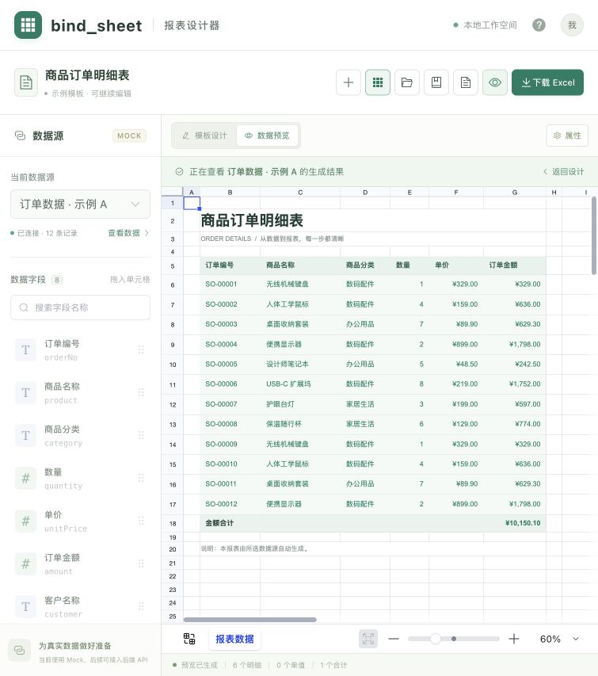

# bind_sheet

一个基于 Vue 3 的纯前端 Excel 报表设计器。将数据源字段拖入表格，保存为模板，再选择数据源生成报表并下载 `.xlsx`。

**设计表格 → 绑定字段 → 保存模板 → 选择数据源 → 生成预览 → 导出 Excel**

[在线体验](https://fangge-report-preview-20261020.spiffylemur4.chatgpt.site) · [变更记录](CHANGELOG.md) · [GitHub 发布准备](docs/GITHUB_PUBLISH.md)

当前使用 Mock 数据，无需后端、账号或 API Key。数据访问通过统一服务层提供，后续可替换为后端接口。

## 界面预览



<details>
<summary>查看快速建表界面</summary>


</details>

## 功能

- **表格设计**：文字、字体、颜色、边框、对齐、数字格式、合并单元格、行高及列宽。
- **字段绑定**：从左侧拖拽或双击字段，在右侧更换字段、调整用途或解除绑定。
- **明细区域**：自选一个明细行，按记录数展开；支持整行移动、撤销与重做，样式、合并及绑定随行保留。
- **快速建表**：批量选择字段、指定明细位置和合计列，自动生成标题、表头及模板行。
- **模板管理**：自动草稿、刷新恢复、保存、另存为，以及模板搜索、复制、重命名和删除。
- **模板检查**：定位字段缺失、类型不兼容、明细跨行、纵向合并等问题。
- **预览与导出**：使用同一份生成结果，返回设计保留模板、选区、滚动位置、缩放及撤销历史。

### 三种绑定用途

| 用途 | 填充规则 | 放置位置 |
| --- | --- | --- |
| 单值 | 读取数据源第 N 条记录，默认第 1 条；记录不存在或值为空时留空 | 任意单元格 |
| 明细 | 整行按每条记录重复展开，并继承模板样式 | 同一个可移动的明细区域 |
| 合计 | 对当前数据源中指定数值字段的全部记录求和 | 任意单元格 |

第 6 行只是示例模板的默认明细位置。可通过「调整明细位置」更改，也可将字段拖到其他行，选择「明细」后移动已有区域。快速建表从第 3 行起安排明细，为标题和表头预留空间；之后仍可移动到其他行。

单值和合计位于明细区域内时，会随整行重复。明细展开后，其下方内容和合并区域同步下移。空数据保留一条空明细行，合计为零。

## 技术栈

| 技术 | 用途 |
| --- | --- |
| Vue 3 + TypeScript | 页面及交互 |
| Vite | 开发与生产构建 |
| Pinia | 设计器状态管理 |
| Element Plus | 表单、对话框与属性面板 |
| Univer | 表格编辑、格式及行列操作 |
| ExcelJS | 浏览器生成 `.xlsx` |
| Decimal.js | 数值合计，避免常见浮点误差 |
| Vitest | 领域逻辑、存储、工作流及导出验证 |

Univer 相关包固定为同一版本，完整依赖版本见 [package.json](package.json) 和锁文件。

## 本地运行

需要 **Node.js 22.12+，推荐 Node.js 24**，以及 npm。

```bash
npm ci
npm run dev
```

打开终端显示的地址，通常为 `http://127.0.0.1:5173/`。

| 命令 | 说明 |
| --- | --- |
| `npm run dev` | 启动本地开发服务器 |
| `npm run typecheck` | TypeScript 类型检查 |
| `npm test` | 运行测试 |
| `npm run build` | 类型检查并生成 `dist/` |
| `npm run preview` | 在构建后预览 `dist/` |

生产版本只需部署 `dist/` 中的静态文件，无需部署后端。`npm run preview` 用于本地检查构建结果。

## 使用流程

1. 打开示例模板，或通过「新建」选择空白模板；「快速建表」可批量生成模板结构。
2. 在左侧选择数据源。内置示例 A（12 条）、示例 B（26 条）和空数据，字段结构相同。
3. 拖拽字段到单元格：明细区域内默认绑定明细；其他位置选择单值、明细或合计。双击字段可绑定到当前选中格。
4. 调整表格格式，通过右侧属性修改字段与用途。需要移动明细时，使用「调整明细位置」。
5. 单元格修改提交后自动保存为草稿；使用「保存模板」（⌘/Ctrl + S）或「另存为」保留命名模板。
6. 点击「生成预览」，切换数据源查看不同结果；「返回设计」继续编辑原模板。
7. 点击「下载 Excel」。设计状态会先提交当前编辑并重新生成；预览状态下载当前可见结果。

## 项目结构

```text
src/
├── components/              # 表格适配、绑定/区域设置、模板库及校验界面
├── domain/
│   ├── types.ts             # 数据源、模板及绑定类型
│   ├── bindings.ts          # 扫描单元格绑定元数据
│   ├── detailRegion.ts      # 根据单元格锚点定位明细区域
│   ├── reportEngine.ts      # 明细展开、单值填充及合计
│   ├── validation.ts        # 生成前的结构与字段校验
│   ├── editGuards.ts        # 绑定与区域元数据的编辑保护
│   └── quickTemplate.ts     # 快速建表
├── services/
│   ├── dataSource.ts        # 数据访问接口的 Mock 实现
│   ├── templateStorage.ts   # 本地模板库、草稿及迁移
│   ├── reportWorkflow.ts    # 提交编辑、生成与下载工作流
│   └── excelExport.ts       # ExcelJS 导出适配
├── stores/designer.ts       # 设计器状态
└── App.vue                  # 页面和交互编排
tests/                       # 领域、编辑保护、存储及导出测试
docs/                        # 截图与 GitHub 发布说明
```

### 模板与数据处理

模板保存版本号、名称和 Univer 工作簿快照。字段绑定位于 `cell.custom.reportBinding`，明细锚点位于 `cell.custom.reportDetailAnchor`，随单元格一起存储，不另外维护固定坐标。生成前重新扫描和校验快照，因此插删行列后按实际位置识别绑定。

生成过程复制模板，展开明细并填充单值、合计，结果不携带设计器绑定标记。预览与导出共用生成快照，原模板不被结果覆盖。

命名模板与自动草稿分别存储在当前浏览器的 localStorage 中。当前实现不上传模板或数据；不同浏览器和不同站点地址之间不会自动同步，清理站点数据会清除本地模板。完整撤销历史仅在本次页面会话内保留。

## 接入后端

组件通过 `DataSourceService` 获取数据，不直接引用 Mock 记录。接口定义在 [src/domain/types.ts](src/domain/types.ts)：

```ts
interface DataSourceService {
  listSources(): Promise<DataSource[]>
  getRows(sourceId: string): Promise<DataRow[]>
}
```

替换 [src/services/dataSource.ts](src/services/dataSource.ts) 的实现，即可对接实际 API。字段描述示例：

```ts
{
  key: 'amount',       // 稳定的业务字段标识
  label: '订单金额',
  type: 'number',      // string | number | date | boolean
  format: '¥#,##0.00'
}
```

记录使用以字段 `key` 为键的对象，例如 `{ amount: 329, customer: '青禾设计' }`。数值返回有限的原生 `number`，布尔值返回 `boolean`，日期返回字符串，空值返回 `null`。

更换数据源时，模板按字段 `key` 和 `type` 匹配。缺少必要字段或类型不兼容会阻止生成；记录中的空值显示为空。单值按返回记录的顺序读取第 N 条，接入后端时应明确查询排序。

## 验证

截至 2026-10-20，当前功能基线已通过：

- 8 个测试文件、86 项测试，包含明细展开、单值/合计、空值/零值/小数、模板兼容与存储迁移。
- 类型检查与生产构建。
- 浏览器实际操作：拖拽、80% 缩放及滚动后的落点、明细整行移动与撤销/重做、区域取消、数据源切换、草稿恢复及编辑后直接下载。
- 实际下载 `.xlsx` 后重读，核对数据、合计、字体、颜色、边框、数字格式、合并和行列尺寸；示例 B 为 26 条记录，金额合计为 35,119.60。

这些是当前版本的验证记录；继续开发时可使用上述命令重新执行自动检查。

## 当前边界

- 面向桌面浏览器；单工作表、一个单行明细区域。可取消明细区域，生成仅含单值和合计的报表。
- 暂不支持文件上传、跨源关联、分组小计、动态交叉表、图表、多人协作、模板文件导入导出及历史版本。
- 暂不支持手写公式的展开和任意 Excel 公式兼容；生成前会提示手写公式问题。
- 导出支持常用单元格格式及布局，不保证任意 Excel 文件无损转换。
- 绑定单元格通过属性面板修改。涉及绑定或明细锚点的剪切、填充、批量粘贴及区域移动会被限制；普通区域保留原生操作，整条明细通过专用入口移动。
- 完整表格内核体积较大，首次加载仍有优化空间；构建会出现依赖指令及 chunk 体积提示。

## 许可证

当前仓库尚未指定开源许可证，未包含 `LICENSE` 文件。发布者可按自己的授权意图补充。
